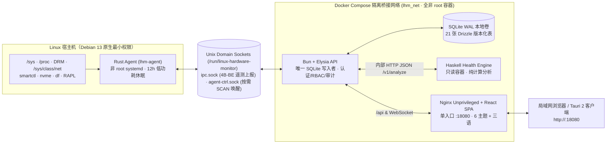

<div align="center">

# Linux Hardware Monitor

**面向 Linux（Debian 13）的低开销、安全加固、可解释硬件监控与健康分析平台**

[-A81D33?logo=debian&logoColor=white)](docs/architecture/versions.md)
[](agents/linux-agent/)
[](apps/api/)
[](core/health-engine/)
[](apps/web/)
[](apps/web/src/lib/theme.tsx)
[](apps/web/src/lib/i18n.tsx)

*非 root 最小权限运行 · 12 小时超低功耗待机 + 一键手动全局体检 · 绝不唤醒待机硬盘 · 绝不用 0 伪造缺失数据*

</div>

---

## 核心特性

| 维度 | 核心能力 |
| ---- | -------- |
| **专业硬件采集（9 类采集器）** | 原生 Rust Agent 只读采集：`hwmon`（主板温度/风扇/电压）、`thermal_zone`、CPU 频率/负载/过热降频计数与 Intel RAPL 封装功耗、内存/Swap 与 EDAC、物理网卡链路速率与收发错包/丢包、持久化分区容量与使用率（`/`、`/media/usb` 等）、SATA/USB 扩展 SMART（固件/转速/SATA 速率/APM/自检历史/三语属性释义，`-n standby` 绝不唤醒待机盘）、NVMe 128-bit 读写与介质错误/异常断电全字段、Intel/AMD/NVIDIA（运行时动态加载 NVML）GPU 遥测。 |
| **可解释健康分析引擎** | 独立无状态 **Haskell 纯函数引擎**：四级阈值优先级、线性趋势斜率、抗离群值污染的鲁棒 **MAD 异常检测**与单步突变检测、高温+停转风扇跨传感器关联分析、5% 滞回防抖告警状态机，以及带逐项扣分依据的 `0–100` 健康评分。 |
| **多主题与三语控制台（16 视图）** | React + ECharts 控制台，内置 **6 套深色/浅色背景主题**（深海蓝灰 / 极夜曜石黑 / 静谧森绿 / 暮光紫韵 / 晨曦浅白 / 护眼米白，自动联动 ECharts 配色与 `localStorage` 持久化）及 **中文 / English / 日本語** 实时切换（覆盖全部界面、诊断日志、Haskell 评分依据与常见 SMART 属性释义）。 |
| **12 小时超低功耗 + 手动即时体检** | 支持 12 小时超低功耗休眠采集（平时零轮询待机，整套空闲 CPU `~0.00%`）；同时在「系统总览」提供管理员专属 **「立即全局健康检测」** 按钮，通过零轮询控制套接字 `agent-ctrl.sock` 即时唤醒 Agent 完成全量采集、聚合与 Haskell 健康评分，结束后立刻恢复休眠。 |
| **安全沙箱与运维保障** | 全非 root 容器（`cap_drop: ALL`、`no-new-privileges`、无 `privileged`、无 host network）；`systemd` 非 root 沙箱实测 **`4.7 OK`**；Argon2id 认证、RBAC、审计日志、CSV 防公式注入导出、SSRF 防护 + HMAC-SHA256 Webhook；默认单高位端口 `18080` 零冲突宿主机既有服务，并内置 `VACUUM INTO` 在线备份与恢复演练脚本。 |

---

## 系统架构



---

## 实机性能与安全实测（Debian 13.6 / Intel Celeron N5095A）

> 以下为在 4 核 Celeron N5095A / 7.5 GiB RAM 物理机（同时运行 Emby 与 40+ 个其他局域网容器）上的真实测量结果：

| 组件 | 运行身份 / 隔离基线 | 资源硬上限 | 静默实测 CPU | 实测内存 |
| ---- | ------------------- | ---------- | ------------ | -------- |
| `lhm-agent.service`（Rust） | 非 root `lhm-agent`，`Nice=10`，`IOSchedulingClass=idle`，`systemd-analyze security` **`4.7 OK`** | `15% CPU / 150 MiB` | **`0.0%`** | **`~1.2–4.8 MiB`** |
| `lhm-health-engine-1`（Haskell） | 非 root `uid=10001`，`read_only: true`，`cap_drop: ALL` | `0.50 CPU / 256 MiB` | **`0.00%`** | **`~12–14 MiB`** |
| `lhm-api-1`（Bun + SQLite） | 非 root `uid=1000`，`cap_drop: ALL` | `0.75 CPU / 512 MiB` | **`0.00%–0.02%`** | **`~40–50 MiB`** |
| `lhm-web-1`（Nginx Unprivileged） | 非 root `uid=101`，`cap_drop: ALL` | `0.25 CPU / 128 MiB` | **`0.00%`** | **`~5–7 MiB`** |
| **整套监控平台合计** | **独立桥接网络，零改动宿主机既有服务与端口** | — | **`~0.00%–0.02%`** | **`~60–75 MiB`** |

---

## 快速部署（Debian 13 / 主流 Linux 局域网开箱即用）

### 前置依赖（宿主机）
- Docker Engine + Docker Compose v2
- Rust 工具链（`1.90+`，用于编译宿主机原生 `lhm-agent`）
- `smartmontools >= 7.0`（用于 SATA/USB/NVMe JSON SMART 读取）；若有 NVMe 盘建议安装 `nvme-cli`

### 1. 克隆仓库并准备环境变量

```bash
git clone https://github.com/vicky-clair/xiaorui-linux-hardware-monitor.git
cd xiaorui-linux-hardware-monitor

cp deploy/docker/.env.example deploy/docker/.env
# 请按本机实际局域网 IP、UID/GID 编辑 deploy/docker/.env：
#   LHM_WEB_PORT=18080
#   LHM_ALLOWED_ORIGINS=http://<主机局域网IP>:18080,http://127.0.0.1:18080
#   LHM_IPC_DIR=/run/linux-hardware-monitor   # 若使用 systemd 生产模式；本地快速体验可保持 ./run
```

### 2. 编译宿主机原生 Rust Agent

```bash
CARGO_BUILD_JOBS=2 cargo build --release -p lhm-agent
```

### 3. 启动非 root 三容器栈（默认端口 `18080`）

```bash
mkdir -p run
COMPOSE_PROJECT_NAME=lhm docker compose \
  --env-file deploy/docker/.env \
  -f deploy/docker/docker-compose.yml up -d --build
```

### 4. 启动原生 Agent（二选一）

- **方式 A（推荐生产：非 root `systemd` 最小权限沙箱，支持开机自启、12h 超低功耗与完整 SMART/RAPL）**：
  详见 [deploy/systemd/README.md](deploy/systemd/README.md)。启用最小权限能力（`CAP_SYS_RAWIO` / `CAP_SYS_ADMIN` / `CAP_DAC_READ_SEARCH` + `disk` 组只读放行）即可在**不使用 `User=root`** 的前提下解锁全部硬盘 SMART 与 Intel RAPL 功耗监控。
- **方式 B（零 `sudo` 快速体验，普通用户权限）**：
  ```bash
  nohup bash deploy/scripts/run-agent-local.sh --interval 60 --discovery-interval 300 > run/agent.log 2>&1 &
  ```
  > 注：普通用户无权读取块设备 SMART 或 Intel RAPL 时，系统会自动在「采集器诊断」中清晰提示 `SMART_PERMISSION_DENIED` / `RAPL_PERMISSION_DENIED`（绝不会误报为硬件故障）。

### 5. 首次初始化管理员并登录

系统**不内置任何默认密码**，首次启动后从 API 日志获取一次性引导令牌：

```bash
docker logs lhm-api-1 2>&1 | grep bootstrap_token
```

在局域网浏览器访问 **`http://<主机局域网IP>:18080`** → 切换至 **「初始化管理员」** → 粘贴令牌并创建管理员账号与密码（≥ 10 位）即可登录使用。

> **可选 HTTPS 反向代理**：默认局域网直连 HTTP，无需启用；如需 TLS 加密，仓库已预置 [deploy/docker/docker-compose.https.yml](deploy/docker/docker-compose.https.yml) 与 [deploy/scripts/gen-self-signed-cert.sh](deploy/scripts/gen-self-signed-cert.sh)，按 [部署手册 §3](docs/deployment/deployment.md) 一键开启即可。

---

## 日常使用指南

1. **手动即时全局体检（12 小时低功耗模式好搭档）**
   - 平时 Agent 处于 12 小时超低功耗休眠状态；需要随时查看最新实时硬件数据时，以 `admin` 身份进入 **「系统总览」**，点击右上角 **「立即全局健康检测」** 按钮即可在 2 秒内唤醒 Agent 完成全量硬件采样、聚合与 Haskell 健康评分，并自动刷新顶部全局告警横幅（内置 10 秒防抖冷却保护硬件）。
2. **切换背景颜色主题与多语言**
   - 在**登录页**或**控制台右上角顶栏**点击 6 个彩色圆点即可一键切换 **深海蓝灰 / 极夜曜石黑 / 静谧森绿 / 暮光紫韵 / 晨曦浅白 / 护眼米白**（自动同步 ECharts 图表配色并记住偏好）；右侧下拉菜单可随时切换 **中文 / English / 日本語**（连同后端诊断日志、Haskell 扣分依据和 SMART 属性释义一并切换）。
3. **查看存储健康、分区空间与 SMART 详情**
   - 进入 **「存储健康 / SMART」**：
     - 顶部卡片直观显示各持久化分区（如 `/`、`/media/usb`）容量与使用率进度条（≥ 85% 橙色警告、≥ 90% 红色预警）；
     - 点击任意硬盘的 **「SMART 详情」**，可查看固件版本、转速/SSD 标识、SATA 速率、当前 APM 档位、最近盘内自检记录、错误日志数、NVMe 扩展指标以及带三语中文释义的 SMART 原始属性表（坏道/待映射/CRC 异常自动高亮）。
4. **开启告警与异常红字提醒**
   - 进入 **「告警中心」**，点击 **「一键应用推荐安全规则」** 即可快速启用覆盖 CPU、存储、GPU、主板的默认安全阈值（也可按设备自定义）；一旦触发 `warning` / `critical`，任意页面顶部均会显示全局橙/红色告警横幅并在左侧导航显示计数角标。
   - 在 **「系统配置」** 中可配置 Webhook 通知（支持 HMAC-SHA256 签名与测试推送，自动拦截 SSRF 危险地址）。
5. **查看 CPU 降频与物理网卡状态**
   - **「CPU 监控」** 包含负载、频率、RAPL 封装功耗及过热降频计数（判断散热是否撞墙）；
   - **「网络接口」** 自动过滤 Docker 虚拟网桥，仅展示真实物理网卡的在线状态、协商速率（如 `1000 Mbps`）与收发错包/丢包/CRC 统计。
6. **数据导出与在线安全备份**
   - 在 **「温度历史」** 页可按时间范围安全导出 CSV / JSON；
   - 在宿主机执行在线 SQLite 快照备份与恢复演练（绝不直接 `cp` 运行中的 WAL 数据库文件）：
     ```bash
     # 在线备份（VACUUM INTO，自动生成 .sqlite 与 .sha256）
     LHM_DOCKER_CONTAINER=lhm-api-1 bash deploy/scripts/backup-sqlite.sh /data/lhm.sqlite ./backups 14

     # 独立恢复演练（自动校验 SHA-256 与 integrity_check，不覆盖生产库）
     bash deploy/scripts/restore-sqlite.sh ./backups/lhm-<UTC>.sqlite /tmp/lhm-restore-drill.sqlite
     ```

---

## 使用注意事项与平台边界（重要）

1. **支持平台与 Docker 限制**
   - **支持**：所有标准 Linux 发行版（Debian 13 为主要实测目标，Ubuntu / Fedora / Arch / Alpine 等主流 Linux 均可部署）。
   - **为什么不能“纯 Docker 一把梭”监控硬件**：为保障安全，本项目**严禁**给 Docker 容器加 `privileged: true` 或挂载宿主机 `/sys`、`/dev`。硬件采集由宿主机原生极轻量 `lhm-agent` 完成，再经本地 Unix Socket 安全投递给非 root 容器。
   - **关于 macOS**：不支持在 macOS 上直接采集 Mac 本机物理硬件（macOS 的 Docker 运行在轻量 Linux 虚拟机内，无法访问 Mac 真实传感器与 SMART）；但可以在 macOS 浏览器中访问局域网 Linux 监控控制台。
2. **正确理解状态语义（绝不误报、绝不造假）**
   - `— (无数据)`：表示当前传感器无有效读数（例如离线无线网卡无协商速率、待机硬盘未唤醒跳过测温）；系统**绝不用 `0` 代替无数据**（只有真实测得的 `0 RPM`、`0 °C` 才会显示为 `0`）。
   - `权限不足`（`permission_denied`）：说明当前进程缺少读取该硬件接口的权限，**不是硬件故障**；按「采集器诊断」中的建议配置非 root `systemd` 最小能力即可解锁。
   - `硬件不支持`（`unsupported`）：说明当前主机硬件/驱动确实未暴露该接口（例如无物理 NVMe 盘、无 ECC 内存、集显无 DRM 温度传感器）。
3. **保护机械硬盘与防止唤醒**
   - 本项目所有机械盘 SMART 采集均强制附带 `-n standby`，硬盘处于休眠状态时直接跳过采集并标记为 `待机（未唤醒）`。
   - 长期外接 USB 机械硬盘与系统盘 SSD 的防磨损实操经验，详见 [双磁盘延寿优化指南](docs/deployment/usb-hdd-optimization.md)。
4. **实机验证 vs 模拟验证范围说明**
   - **已在实体机（Debian 13.6 / Intel N5095A）完整验证**：CPU 温度/频率/负载/RAPL 功耗/过热降频、内存与 Swap、物理网卡（`enp2s0` / `wlp1s0`）、持久化分区容量（`/` / `/media/usb`）、SATA SSD 与 USB 3.0 机械盘完整 SMART 扩展属性、Haskell 健康评分、12h 低功耗模式、手动全局健康检测与非 root `systemd` 沙箱。
   - **已通过跨语言协议与模拟硬件测试、尚未在对应实体硬件上真机验证**：物理 NVMe 盘（`nvme-cli`）、NVIDIA 独显（动态加载 NVML）、AMD 独显（`amdgpu`）、服务器 ECC/EDAC 内存与 IPMI 传感器，以及 7 天连续稳定性压测。
5. **升级前务必备份，切勿执行 `docker compose down -v`**
   - 管理员账号与全部历史遥测数据保存在 Docker 卷 `lhm_lhm_sqlite_data` 中；日常更新容器请使用 `docker compose ... up -d --build`，切勿带 `-v` 清除数据卷。

---

## 仓库目录与文档导航

```text
├── agents/linux-agent/     # Rust 原生宿主机采集 Agent（agent-core / 9 类 collectors / ipc / bin）
├── apps/api/               # Bun + Elysia + Drizzle ORM 后端 API 与 SQLite 版本化迁移
├── apps/web/               # React 19 + Vite + ECharts（6 主题 + 三语 + 16 视图控制台）
├── apps/desktop/           # Tauri 2 桌面客户端脚手架（纯 UI 客户端）
├── core/health-engine/     # Haskell + Cabal 无状态纯计算健康分析引擎
├── packages/protocol/      # JSON Schema Draft 2020-12 唯一事实来源（v1.2）与三端类型/样例
├── deploy/                 # 非 root Docker Compose / Nginx / systemd 沙箱 / 在线备份与恢复脚本
├── docs/                   # 开发者指南、部署手册、双盘优化手册、各模块规范与 ADR 0001–0010
└── scripts/                # 本地与实机全量 CI 脚本（ci.ps1 / ci.sh / sync-to-l3.ps1）
```

### 核心文档索引

| 文档 | 说明 |
| ---- | ---- |
| **[docs/DEVELOPER_GUIDE.md](docs/DEVELOPER_GUIDE.md)** | **开发者完整指南**（架构原理、各语言模块详解、本地与实机开发联调、排错速查） |
| [docs/deployment/deployment.md](docs/deployment/deployment.md) | 生产部署手册、可选 HTTPS 启用步骤、在线备份/恢复演练与实测基准 |
| [docs/deployment/usb-hdd-optimization.md](docs/deployment/usb-hdd-optimization.md) | 宿主机双磁盘延寿优化指南（外接 USB 硬盘 `udev`/`fstab`/APM + 系统盘 SSD `journald`/`swappiness`/`noatime` 与回滚手册） |
| [deploy/systemd/README.md](deploy/systemd/README.md) | 非 root `systemd` 沙箱加固安装与 `systemd-analyze security` 审计指南 |
| [docs/collectors/hardware-scope.md](docs/collectors/hardware-scope.md) | 9 类硬件采集范围、稳定设备 ID、SMART/NVMe 与低功耗调度规范 |
| [docs/database/schema.md](docs/database/schema.md) | SQLite 21 张表结构、Drizzle 迁移清单、写入性能基准与保留策略 |
| [docs/api/api-spec.md](docs/api/api-spec.md) | REST API（含 `POST /api/v1/system/check`）、WebSocket、CSV/JSON 导出与 Webhook 规范 |
| [docs/web/ui-spec.md](docs/web/ui-spec.md) | React Web 16 视图、6 主题、三语国际化与四维状态渲染规范 |
| [docs/decisions/README.md](docs/decisions/README.md) | 架构决策记录清单（ADR-0001 至 ADR-0010） |
| [docs/status.md](docs/status.md) | 阶段 0–6 开发进度、实机验收与模拟验证边界清单 |
| [AGENTS.md](AGENTS.md) | 项目工程纪律、安全红线与命令表 |

---

## 本地全量验证（CI）

```powershell
# Windows 开发工作站（L0）：一次校验 TS / Protocol / API / Web / Rust / Haskell
pwsh -File scripts/ci.ps1
```

```bash
# Debian 13 Linux 环境（L1 / L3）
bash scripts/ci.sh
```
