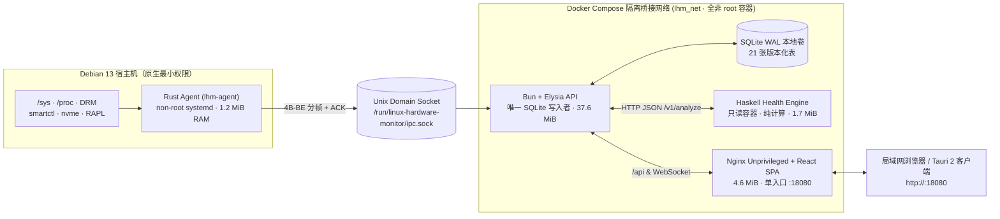

<div align="center">

# Linux Hardware Monitor

**面向 Debian 13 的低开销、安全加固、可解释硬件监控与健康分析平台**

[-A81D33?logo=debian&logoColor=white)](docs/architecture/versions.md)
[](agents/linux-agent/)
[](apps/api/)
[](core/health-engine/)
[](apps/web/)
[](apps/web/src/lib/i18n.tsx)

*非 root 最小权限运行 · 绝不唤醒待机硬盘 · 绝不用 0 伪造缺失数据 · 实测整套仅占 ~0.03% CPU / ~49 MiB 内存*

</div>

---

## 核心特性

| 维度 | 核心能力 |
| ---- | -------- |
| **硬件真实采集** | 原生 Rust Agent 覆盖 `hwmon`、`thermal_zone`、CPU 频率/负载与 Intel RAPL 封装功耗、内存与 EDAC、SATA/USB 磁盘 SMART（`-n standby` 绝不唤醒待机盘）、NVMe 128-bit 精确计数、Intel/AMD/NVIDIA（动态加载 NVML）GPU 遥测。 |
| **可解释健康分析** | 独立无状态 **Haskell 纯函数引擎**：四级阈值优先级、趋势识别、抗离群值污染的鲁棒 **MAD 异常检测**与单步突变检测、高温+停转风扇关联分析、5% 滞回防抖告警状态机，以及带扣分依据的 `0–100` 健康评分。 |
| **醒目可视化与三语切换** | React + ECharts 暗色控制台，支持 **中文 / English / 日本語** 实时切换（覆盖全部界面与诊断/分析日志）；任意页面顶部**全局红/橙色告警横幅** + 侧边栏计数角标 + 异常行红字高亮 + 一键应用推荐安全规则。 |
| **安全与极低开销** | 全非 root 容器（`cap_drop: ALL`、`no-new-privileges`、无 `privileged`、无 host network）；`systemd` 非 root 沙箱实测 **`4.7 OK`**；分级调度 + `Nice=10` / `IOSchedulingClass=idle`；Argon2id 认证、RBAC、审计日志、CSV 防公式注入导出、SSRF 防护 + HMAC-SHA256 Webhook。 |
| **开箱即用局域网部署** | 默认单高位端口（`18080`）直连 HTTP，零冲突宿主机 `80`/`443` 与既有 Nginx；同时完整预置可选 HTTPS 反向代理模板与自签名 SAN 证书脚本，以及基于 `VACUUM INTO` 的 SQLite 在线备份与恢复演练脚本。 |

---

## 系统架构



---

## 实机性能与安全实测（Debian 13.6 / Intel Celeron N5095A）

> 以下为 2026-11-20 在目标物理机（4 核 Celeron N5095A / 7.5 GiB RAM，同时运行其他局域网服务）上的真实运行测量结果：

| 组件 | 运行身份 / 隔离基线 | 资源硬上限 | 实测 CPU | 实测内存 |
| ---- | ------------------- | ---------- | -------- | -------- |
| `lhm-agent.service`（Rust） | 非 root `lhm-agent`，`Nice=10`，`IOSchedulingClass=idle`，`systemd-analyze security` **`4.7 OK`** | `15% CPU / 150 MiB` | **`0.0%`** | **`1.2 MiB`**（峰值 `2.8 MiB`） |
| `lhm-health-engine-1`（Haskell） | 非 root `uid=10001`，`read_only: true`，`cap_drop: ALL` | `0.50 CPU / 256 MiB` | **`0.00%`** | **`1.73 MiB`** |
| `lhm-api-1`（Bun + SQLite） | 非 root `uid=1000`，`cap_drop: ALL` | `0.75 CPU / 512 MiB` | **`0.03%`** | **`37.62 MiB`** |
| `lhm-web-1`（Nginx Unprivileged） | 非 root `uid=101`，`cap_drop: ALL` | `0.25 CPU / 128 MiB` | **`0.00%`** | **`4.64 MiB`** |
| **整套监控平台合计** | **独立桥接网络，零改动宿主机既有服务** | — | **~`0.03%`** | **~`45–49 MiB`** |

---

## 快速部署（Debian 13 局域网开箱即用）

### 1. 准备环境变量（避开宿主机 80 / 443 端口）

```bash
git clone https://github.com/vicky-clair/xiaorui-linux-hardware-monitor.git
cd linux-hardware-monitor

cp deploy/docker/.env.example deploy/docker/.env
# 按本机实际局域网 IP、UID/GID 调整 deploy/docker/.env 中的 LHM_ALLOWED_ORIGINS 与 LHM_IPC_DIR
```

### 2. 编译原生 Rust Agent

```bash
CARGO_BUILD_JOBS=2 cargo build --release -p lhm-agent
```

### 3. 启动非 root 三容器栈（默认局域网 HTTP 端口 `18080`）

```bash
mkdir -p run
COMPOSE_PROJECT_NAME=lhm docker compose \
  --env-file deploy/docker/.env \
  -f deploy/docker/docker-compose.yml up -d --build
```

### 4. 启动原生 Agent（二选一）

- **方式 A（推荐生产：非 root `systemd` 沙箱，支持开机自启与 SMART / RAPL）**：
  详见 [deploy/systemd/README.md](deploy/systemd/README.md)（按需在 `/etc/systemd/system/lhm-agent.service` 中启用方案 A 或方案 B 最小能力，并将 `.env` 中 `LHM_IPC_DIR` 指向 `/run/linux-hardware-monitor`）。
- **方式 B（零 `sudo` 快速体验，仅普通用户权限）**：
  ```bash
  nohup bash deploy/scripts/run-agent-local.sh --interval 5 --discovery-interval 60 > run/agent.log 2>&1 &
  ```

### 5. 首次初始化管理员并登录

系统**不内置默认密码**，请从启动日志获取一次性初始化令牌：

```bash
docker logs lhm-api-1 2>&1 | grep bootstrap_token
```

在局域网浏览器访问 **`http://<主机局域网IP>:18080`** → 切换至 **「初始化管理员」** → 粘贴令牌并设置管理员账号与密码（≥ 10 位）即可使用。

> **可选 HTTPS 反向代理**：仓库已完整备妥 [deploy/nginx/https.conf.template](deploy/nginx/https.conf.template)、[deploy/docker/docker-compose.https.yml](deploy/docker/docker-compose.https.yml) 与 [deploy/scripts/gen-self-signed-cert.sh](deploy/scripts/gen-self-signed-cert.sh)。默认局域网 HTTP 无需启用；如需 HTTPS，按 [部署手册 §3](docs/deployment/deployment.md) 一键开启即可。

---

## 日常运维与在线备份

```bash
# 1. SQLite 在线快照备份（基于 VACUUM INTO，安全兼容 WAL，绝不直接 cp 活库）
LHM_DOCKER_CONTAINER=lhm-api-1 bash deploy/scripts/backup-sqlite.sh /data/lhm.sqlite ./backups 14

# 2. 独立恢复演练（自动校验 SHA-256 与 PRAGMA integrity_check，不覆盖生产库）
bash deploy/scripts/restore-sqlite.sh ./backups/lhm-<UTC>.sqlite /tmp/lhm-restore-drill.sqlite
```

---

## 仓库目录与文档导航

```text
├── agents/linux-agent/     # Rust 原生宿主机采集 Agent（agent-core / collectors / ipc / bin）
├── apps/api/               # Bun + Elysia + Drizzle ORM 后端 API 与 SQLite 迁移
├── apps/web/               # React 19 + Vite + ECharts 三语监控控制台
├── apps/desktop/           # Tauri 2 桌面客户端脚手架（纯 UI 客户端）
├── core/health-engine/     # Haskell + Cabal 无状态纯计算健康分析引擎
├── packages/protocol/      # JSON Schema Draft 2020-12 唯一事实来源与三端类型/样例
├── deploy/                 # Docker Compose / 非 root Dockerfile / Nginx / systemd / 备份脚本
├── docs/                   # 完整规范、开发者指南、部署手册与 ADR 0001–0010
└── scripts/                # 本地与实机全量 CI 脚本（ci.ps1 / ci.sh / sync-to-l3.ps1）
```

### 核心文档索引

| 文档 | 说明 |
| ---- | ---- |
| **[docs/DEVELOPER_GUIDE.md](docs/DEVELOPER_GUIDE.md)** | **开发者完整指南**（架构原理、各语言模块详解、本地与实机开发联调、排错速查） |
| [docs/deployment/deployment.md](docs/deployment/deployment.md) | 生产部署手册、可选 HTTPS 启用步骤、在线备份/恢复演练与实测基准 |
| [deploy/systemd/README.md](deploy/systemd/README.md) | 非 root `systemd` 沙箱加固安装与 `systemd-analyze security` 审计指南 |
| [docs/api/api-spec.md](docs/api/api-spec.md) | REST API、WebSocket 增量推送、CSV/JSON 导出与 Webhook 通知接口规范 |
| [docs/decisions/README.md](docs/decisions/README.md) | 架构决策记录清单（ADR-0001 至 ADR-0010） |
| [docs/status.md](docs/status.md) | 阶段 0–6 开发与实机验收记录 |
| [AGENTS.md](AGENTS.md) | 项目工程纪律、安全红线与命令表 |

---

## 本地全量验证（CI）

```powershell
# Windows 开发工作站（L0）：一次校验 TS / Protocol / API / Web / Rust / Haskell
pwsh -File scripts/ci.ps1
```

```bash
# Debian 13 Linux 环境（L1 / L3）
bash scripts/ci.sh
```
