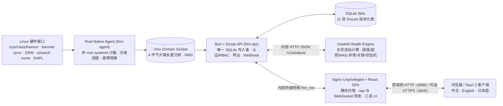

# Linux Hardware Monitor — 开发者指南（Developer Guide）

> 适用平台：Debian 13（目标运行环境） / Windows 11 + PowerShell（本地开发工作站）
> 架构规范入口：[AGENTS.md](../AGENTS.md) ｜ 阶段状态：[status.md](status.md) ｜ 架构决策：[decisions/README.md](decisions/README.md)

---

## 1. 系统架构与语言职责边界

本项目采用**多语言职责严格隔离**的 Monorepo 架构，每个组件仅承担其最擅长且边界清晰的职责：



### 强制职责隔离红线

| 模块 | 允许职责 | 严禁行为 |
| ---- | -------- | -------- |
| **Rust Agent** (`agents/linux-agent/`) | 硬件发现、稳定设备 ID、8 类采集器、分级调度、本地诊断、Unix Socket IPC 发送 | 读写 SQLite、Web 业务、单个采集器异常导致进程崩溃、使用 `User=root` |
| **Bun API** (`apps/api/`) | IPC 接收校验与去重、SQLite 唯一写入、聚合与保留清理、Argon2id 会话/RBAC/审计、REST & WebSocket、安全导出与 Webhook | 读取宿主机 `/sys`/`/proc`/`/dev`、执行外部硬件命令、静默吞异常 |
| **Haskell Engine** (`core/health-engine/`) | 纯函数健康评分、四级阈值解析、趋势/鲁棒 MAD 异常/关联检测、带滞回防抖的告警状态机 | 读取 `/sys` `/proc`、访问数据库、持有跨请求持久化状态 |
| **React Web** (`apps/web/`) | 实时/历史数据可视化、三语界面与日志本地化、全局告警展示与交互 | 在前端推断硬件健康状态、将 `null` 缺失值补零为 `0`、绕过 API |
| **Tauri 2 Desktop** (`apps/desktop/`) | 轻量桌面外壳连接局域网控制台 | 服务端硬件采集、直连数据库 |

---

## 2. Monorepo 目录结构与核心入口

```text
linux-hardware-monitor/
├── packages/protocol/                 # 跨语言共享协议（JSON Schema Draft 2020-12 唯一事实来源）
│   ├── schemas/                       # host / device / sensor / reading / smart / ipc / analyze Schema
│   ├── examples/{valid,invalid}/      # 三端黄金正反测试样例
│   ├── typescript/                    # @lhm/protocol（Ajv 校验 + 4 字节大端分帧）
│   ├── rust/                          # lhm-protocol crate（serde 强类型 + 128-bit UintString）
│   └── haskell/                       # lhm-protocol cabal 包（aeson 编解码）
├── agents/linux-agent/                # Rust 原生宿主机采集 Agent（由根 Cargo.toml 统一 workspace）
│   └── crates/
│       ├── agent-core/                # SysFs 抽象、CommandRunner 白名单、稳定 ID、分级调度器 scheduler.rs
│       ├── agent-collectors/          # hwmon / thermal / cpu(RAPL) / memory / storage / smart / nvme / gpu
│       ├── agent-ipc/                 # Unix Socket 客户端、握手 ACK、有界缓冲与退避重连
│       └── agent-bin/                 # lhm-agent 可执行入口（--once / --send-once / 常驻模式）
├── apps/api/                          # Bun + Elysia + Drizzle ORM 后端服务
│   ├── src/
│   │   ├── index.ts                   # 服务启动、Unix Socket 监听、60s 分析与每小时清理调度
│   │   ├── app.ts                     # Elysia 路由装配与统一响应信封
│   │   ├── config/env.ts              # 环境变量配置解析
│   │   ├── auth/                      # Argon2id 密码哈希、一次性引导令牌、SHA-256 会话 Cookie、登录限流
│   │   ├── ipc/                       # unixServer.ts 分帧监听 + processor.ts 校验去重入库
│   │   ├── repositories/              # db.ts(SQLite WAL) / schema.ts(21 表) / telemetry / aggregation / alert / auth
│   │   ├── routes/                    # health / auth / telemetry / alerts / extensions(导出与 Webhook)
│   │   ├── services/                  # healthClient.ts(Haskell 调用与降级) / notifier.ts(SSRF 防护 Webhook)
│   │   └── websocket/hub.ts           # Origin 校验、Cookie 鉴权与订阅增量推送
│   ├── drizzle/                       # Drizzle 版本化 SQL Migration（禁止手工改表）
│   └── tests/                         # 7 套自动化测试（认证、IPC、持久化、WebSocket、告警、阶段 6 扩展）
├── apps/web/                          # React 19 + TypeScript + Vite 6 + ECharts 5 控制台
│   └── src/
│       ├── App.tsx                    # 根布局、侧边栏计数角标、GlobalAlertBanner 全局红/橙告警横幅
│       ├── lib/i18n.tsx               # 中文 / English / 日本語 全站词典与诊断日志/分析本地化翻译器
│       ├── lib/format.ts              # null 与 0 严格区分格式化、多粒度时间范围映射
│       ├── components/                # 统一加载/空/错误/权限提示、状态徽章、ECharts（connectNulls=false）
│       └── pages/                     # 15 个监控与管理页面（含告警规则预设与 CSV/JSON 导出）
├── apps/desktop/                      # Tauri 2 桌面客户端薄外壳脚手架（独立于服务端 Cargo.toml）
├── core/health-engine/                # Haskell + Cabal 健康分析引擎
│   ├── app/Main.hs                    # 无状态 HTTP/1.1 JSON 服务（GET /health, POST /v1/analyze，4 MiB 上限）
│   ├── src/Health/                    # 10 个纯函数模块（Types/Protocol/Rules/Thresholds/Trends/Anomaly/Correlation/Scoring/StateMachine/Engine）
│   └── test/Main.hs                   # 核心不变式、MAD/突变异常、滞回状态机单元测试
├── deploy/                            # 生产部署编排与运维脚本
│   ├── docker/                        # 非 root Dockerfile（锁定 SHA-256 Digest）、docker-compose.yml、可选 https 覆写
│   ├── nginx/                         # 默认局域网 HTTP default.conf + 备妥的可选 https.conf.template
│   ├── systemd/                       # ADR-0006 非 root 沙箱加固单元与 tmpfiles.d 配置
│   └── scripts/                       # VACUUM INTO 在线备份、恢复演练、自签名 SAN 证书生成、低优先级本地启动
├── docs/                              # 架构、API、数据库、安全、部署、测试规范与 ADR 0001–0010
└── scripts/                           # ci.ps1（L0 全量检查）、ci.sh（L3 检查）、sync-to-l3.ps1（安全同步）
```

---

## 3. 核心协议与数据模型约定

修改任何跨语言字段时，必须同步更新 `packages/protocol/schemas/`、TypeScript/Rust/Haskell 绑定、黄金样例与 `CHANGELOG.md`。

1. **四个独立状态维度（严禁混用）**：
   - `capability_status`：`supported` / `unsupported` / `permission_denied` / `unavailable` / `unknown`
   - `quality`：`valid` / `stale` / `sensor_fault` / `out_of_range` / `missing`
   - `device_status`：`online` / `standby` / `offline` / `unknown`
   - `severity`（仅分析与告警）：`normal` / `warning` / `critical` / `unknown`
2. **绝不用 `0` 表示无数据**：缺失读数必须传输 `value: null` + 非 `valid` 的 `quality`；有效零值（如 `0 RPM` 停转风扇、`0 Hz` 空闲 GPU 频率）保留 `value: 0` + `quality: "valid"`。
3. **128-bit 大整数精确传输**：超过 JS `2^53` 精度的 SMART / NVMe 读写计数统一采用十进制字符串 `UintString`。
4. **稳定设备 ID**：依据 PCI BDF、磁盘 WWN/序列号或拓扑路径生成（如 `gpu-pci-0000-00-02-0`、`disk-wwn-naa-50000000000027b6`），重启后不漂移。
5. **IPC 分帧协议（ADR-0003）**：Unix Domain Socket 传输采用 `4 字节无符号大端长度前缀 + UTF-8 JSON 载荷`（单帧硬上限 `1 MiB`），服务端按 `(agent_instance_id, sequence)` 去重并返回 ACK。

---

## 4. 各子系统开发要点

### 4.1 Rust Agent（低开销分级采集与安全执行）

- **分级调度（`scheduler.rs` `run_tick`）**：
  - 默认每 `5s` 驱动一次轻量传感采集，硬件设备发现结果缓存 `60s`（避免频繁遍历 `/sys` 与重复写库）；
  - `SmartCollector` 内置双频任务（温度 `30s` / 全量 SMART 属性 `900s`），统一携带 `-n standby --json=c` 参数，绝不唤醒待机 HDD；
  - 对返回 `PermissionDenied` 的任务自动退避至 `300s`，防止无权限环境下频繁拉起子进程。
- **外部命令白名单（`command.rs`）**：仅允许绝对路径白名单（`/usr/sbin/smartctl`、`/usr/sbin/nvme`、`/usr/bin/nvidia-smi`），数组传参、强制超时、输出上限 `2 MiB`。
- **低优先级与沙箱运行**：通过 `Nice=10`、`IOSchedulingClass=idle`、`MemoryMax=150M`、`CPUQuota=15%` 与非 root `lhm-agent` 专用用户运行，实测 L3 实体机常驻内存约 `1.2 MiB`、CPU 约 `0.0%`。

### 4.2 Bun + Elysia API（数据持久化、认证与安全扩展）

- **SQLite 并发与生命周期**：WAL 模式 + 5s `busy_timeout` + 外键约束 + `auto_vacuum = INCREMENTAL`；后台定时执行可重入 `1m` / `1h` 聚合与每小时一次的分批保留清理（仅清理已聚合的过期原始数据）。
- **认证与安全边界**：
  - 首次启动无用户时生成内存一次性 `bootstrap_token`（写入启动日志，使用后即作废）；
  - 密码采用 `Bun.password` Argon2id 哈希；会话 Cookie 启用 `HttpOnly` + `SameSite=Lax`（HTTPS 模式下自动开启 `Secure`），数据库仅保存令牌 SHA-256 哈希；
  - 登录失败按用户名与 IP 限流（15 分钟 5 次）；管理员写操作（用户、配置、规则、告警确认、通知配置）全部记入 `audit_logs`。
- **数据导出与 Webhook 安全**：
  - `GET /api/v1/export/readings` 单次硬上限 `10,000` 行，CSV 自动对 `= + - @` 开头字符串做防公式注入转义；
  - `GET /api/v1/export/report` 自动剔除用户表、会话表与 `is_sensitive=1` 敏感配置；
  - Webhook 内置 SSRF 校验（拦截 `169.254.0.0/16`、`fe80::`、`0.0.0.0`、非 `http/https`、内嵌账号密码 URL）与 `X-LHM-Signature: sha256=...` HMAC 签名。

### 4.3 Haskell 健康分析引擎（纯函数分析流水线）

- 单次请求通过 `Health.Engine.analyze` 完成确定性计算：
  1. **阈值解析（`Health.Thresholds`）**：用户单设备规则 > 硬件驱动限值 > 通用默认阈值（CPU/GPU `85°C`、存储 `60°C`、主板 `75°C`）> 不可用；
  2. **异常检测（`Health.Anomaly`）**：鲁棒 MAD 修正 Z-Score（`ROBUST_MAD_SPIKE`）+ 均值 Z-Score 兜底 + 单步突变检测（`SUDDEN_STEP_CHANGE`，跳变 `≥ 12.0`）；
  3. **关联分析（`Health.Correlation`）**：如高温伴随风扇 `0 RPM` 停转（`THERMAL_WITH_STOPPED_FAN`）；
  4. **状态机（`Health.StateMachine`）**：`Ok → Pending → Firing → Resolved`，恢复需越过 `5%` 滞回带宽以防抖动；
  5. **可解释评分（`Health.Scoring`）**：`0..100` 或 `Nothing`（过期/故障/无有效采样绝不评为正常）。

### 4.4 React Web 控制台（三语国际化与全局视觉报警）

- **全站三语支持（`apps/web/src/lib/i18n.tsx`）**：支持 `中文`、`English`、`日本語` 即时切换（持久化至 `localStorage`），同时将后端结构化诊断错误码与 Haskell 分析依据翻译为对应语言并保留原始错误码与设备路径。
- **全局红字报警（`App.tsx` / `AlertsPage.tsx` / `AnalysisPage.tsx`）**：
  - 任意页面顶部实时展示 `GlobalAlertBanner`（存在 `firing` 告警或 `critical` 设备时弹出醒目红色横幅，存在 `warning` 时弹出橙色横幅）；
  - 左侧导航「告警中心」与「健康评分与分析」显示实时红色/橙色计数角标；
  - 表格中触发中的告警行、严重异常设备行与 SMART 未通过项均以红字高亮，且「告警中心」提供「一键应用推荐安全规则」。

---

## 5. 本地开发（L0）与实机联调（L3）工作流

### 5.1 本地 L0（Windows PowerShell）常用命令

```powershell
# 安装 JS/TS 依赖（锁定 bun.lock）
bun install --frozen-lockfile

# 一键执行全量本地 CI（TS 类型检查 + Protocol/API/Web 单测 + Web 构建 + Rust fmt/clippy/test + Haskell build/test）
pwsh -File scripts/ci.ps1

# 单独调试前端（默认代理 /api 至 http://127.0.0.1:3000）
bun --filter @lhm/web dev

# 新增数据库 Migration（修改 apps/api/src/repositories/schema.ts 后执行）
bun --filter @lhm/api db:generate
```

### 5.2 L3（Debian 13 实机）安全同步与构建

- 使用 [sync-to-l3.ps1](../scripts/sync-to-l3.ps1) 基于 `git archive HEAD` 将已提交代码安全同步至远程隔离目录 `~/linux-hardware-monitor`（不会传输本地数据库、构建产物或密钥）。
- 在低功耗宿主机（如 Celeron N5095A）上编译 Rust 时建议限制并发：`CARGO_BUILD_JOBS=2 cargo build --release -p lhm-agent`。
- Haskell 容器镜像已启用 BuildKit Cabal 依赖缓存（`Dockerfile.health-engine`），修改 `.hs` 源码后增量构建仅需约 25 秒。

---

## 6. 故障排查与维护速查

| 现象 | 排查方式 |
| ---- | -------- |
| 磁盘无 SMART 属性（`SMART_PERMISSION_DENIED`） | 检查 `systemctl status lhm-agent.service` 是否以方案 A/B 启用了 `disk` 组与 `CAP_SYS_RAWIO` / `CAP_SYS_ADMIN` |
| 忘记首次初始化令牌 | 执行 `docker logs lhm-api-1 2>&1 \| grep bootstrap_token`（创建首个管理员后自动失效） |
| 健康分析显示「未知 / 引擎不可达」 | 检查 `docker ps` 中 `lhm-health-engine-1` 是否为 `healthy`，查看 `docker logs lhm-api-1` |
| SQLite 在线备份与恢复演练 | 严禁直接 `cp` 活库；使用 `LHM_DOCKER_CONTAINER=lhm-api-1 bash deploy/scripts/backup-sqlite.sh /data/lhm.sqlite ./backups 14` 与 `restore-sqlite.sh` |
| 需要启用局域网 HTTPS | 按 [deployment.md](deployment/deployment.md) §3 执行 `gen-self-signed-cert.sh` 并叠加 `-f deploy/docker/docker-compose.https.yml` 启动 |
